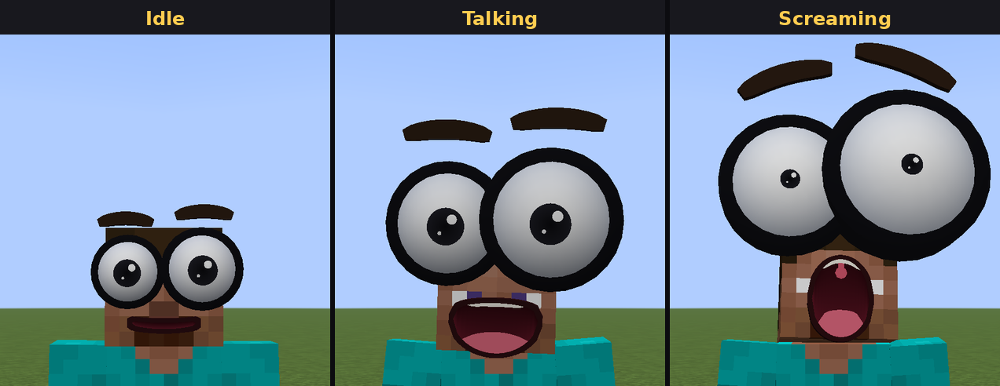
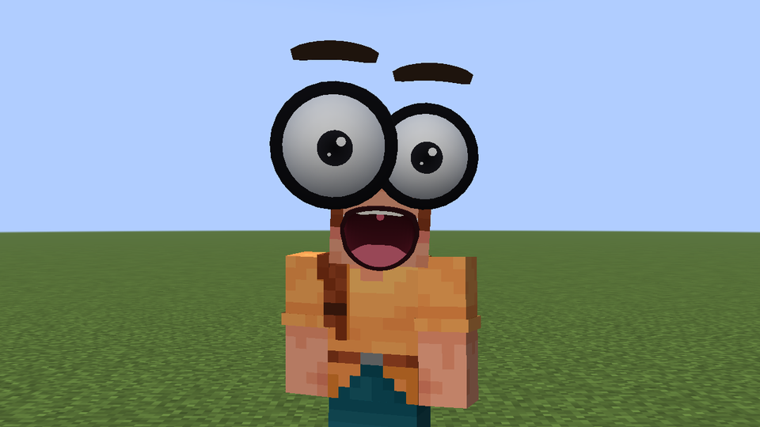
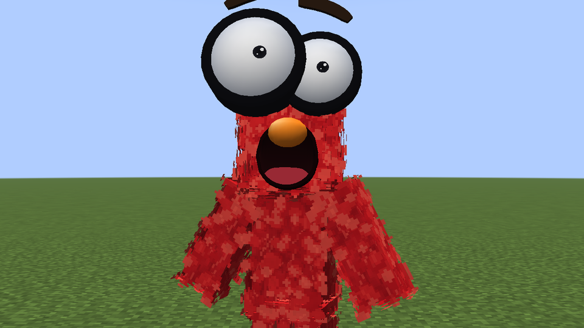
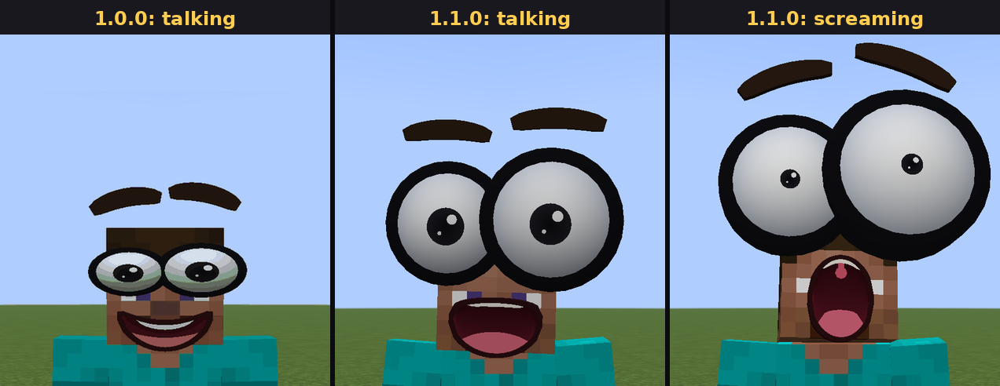

# EyeBall Mod

Gives Minecraft players **enormous 3D googly eyes**, big cartoon eyebrows and a talking mouth.
When someone talks, their eyes **swell up to about 1.6x** and their mouth flaps **wide open**;
when they scream (`AAAAHHH`, or yelling into Simple Voice Chat) the eyes get even bigger, the mouth
becomes a huge trembling oval and the head shakes. Hit someone and their eyes turn into **huge
spinning hypnotic spirals** while their mouth drops open in shock. There's also an optional
**fluffy red Elmo-style transformation** with the same facial animations.

**Minecraft 26.3 and 26.2 · Fabric · client + optional server**


**Watching another player** (from 3 blocks away): idle, talking, screaming



| Talking | Screaming | Hit reaction | Elmo screaming |
| --- | --- | --- | --- |
|  |  |  |  |


## What's new in 1.1.0



- **Much bigger talking animations.** Talking eyes swell to about 1.6x (was 1.05x) with a pop
  when talking starts and a smooth shrink when it stops; the mouth opens more than twice as far
  (a scream about 3.5 times as far), in a different shape every syllable, and stretches as it
  opens. The brows bounce harder and the head nods and sways.
- **New screaming face** for `AAAAHHH`, `NOOOO`, shouted `HELP!!`, `😱`, yelling into Simple Voice
  Chat, a new keybind and `/eyeball expression screaming`.
- **New sliders:** Eye Enlargement, Mouth Opening and Overall Exaggeration, next to Animation Speed
  and Expression Intensity in a new *Talking & Expressions* section.
- Smooth everywhere: expressions cross-fade, big eyes never cover the mouth, and the eyes hold
  still above a flapping mouth.
- New previews: Screaming, Laughing and Elmo Scream.
- Fixed: at 2x Animation Speed a face's mouth could break and disappear; turning Blinking off now
  also stops a blink that is happening at that moment.

## Features

**Googly eyes**
- Real 3D eyeballs that stick out of the face: black plastic rim, shaded white dome, big pupils
  with shiny highlights. Not a flat image.
- Pupils behave like loose googly-eye discs. They follow where the player looks, glance at you
  and at nearby players, lag behind head turns, drop when landing and bounce off the rim. The two
  eyes move independently, and every player gets slightly different, goofy eye sizes.
- Random blinking (sometimes a double blink), happy squinting.
- Eyes bob with every step and bounce when jumping and landing.

**Talking and expressions** (big, cartoony and impossible to miss)
- When a player talks, **both eyes swell to about 1.5-1.8x** their size (with a springy pop when
  they start, a little pulse on every stressed syllable, and a smooth shrink back when they stop).
  The googly pupils keep wobbling on their own and jiggle with the words.
- The **mouth opens wide** and changes shape with every syllable: a huge "AH", a round "OH", an
  "EH", a toothy "EE" grin, a small "OO". Loud syllables get the big shapes. It stretches up and a
  little sideways as it opens, with tongue and teeth.
- The eyebrows bounce, and the head nods and sways while talking.
- **Screaming**: `AAAAHHHH`, `NOOOOO`, `eeeek`, shouted `HELP!!` or `😱`, or yelling into the
  microphone for a moment. The eyes get enormous (about 2x) with tiny terrified pupils, the mouth
  opens into a huge trembling oval (you can see the uvula), the eyebrows shoot up and the head
  shakes and is thrown back. Elmo flails his arms.
- The face matches the message: laughing (`haha`, `lol`, `xD`), surprised (`wow`, `?!`),
  shouting (ALL CAPS), screaming, angry (`grr`, `>:(`), excited (`yay!`, `let's go`), happy
  (`:)`), confused (`huh?`) and a small talking mouth for short replies.
- Every change blends smoothly: expressions cross-fade, every value moves through springs, and
  the face is laid out so big eyes never cover the mouth and the mouth never hangs off the chin.
- Works on servers that reformat chat as system messages (`[Rank] Name: hi`, `Name » hi`).
- **Voice lip sync** with [Simple Voice Chat](https://modrinth.com/plugin/simple-voice-chat):
  mouths follow the actual voice volume of whoever is speaking (louder = wider), and yelling turns
  into the screaming face (optional, not required).
- Make faces on purpose with keybinds (surprised, angry, laughing, excited, happy, confused,
  screaming).

**Eyebrows**
- Oversized arched brows that move up and down, tilt for anger, go one-up-one-down when
  confused, shoot up when surprised, grow bigger when the face gets expressive and wiggle when
  dizzy. They can be hidden, or kept but frozen, separately.

**Hit reaction: spiral eyes**
- Taking damage from anything (players, mobs, falling, fire, explosions) instantly swaps the eyes
  for huge black-and-white spirals that spin, then spin down. The mouth drops open in shock, the
  head wobbles into a dizzy sway, the body staggers, and cartoon stars orbit the head.
- A recovery blink turns the spirals back into normal eyes.
- Priority is strict: a hit interrupts talking, and when the reaction ends the face goes back to
  talking if the player is still talking, otherwise to normal.

**Elmo-style transformation**
- A separate mode with an original model: oversized rounded head, red fur (3 layers of fur
  "shells" for a fluffy silhouette), big googly eyes, an orange oval nose and a big black mouth.
- Talks with its mouth, head and arms, blinks, bounces when walking, and gets spiral eyes when
  hit. In first person your arms become red and furry.
- Works together with or independently of the googly eyes.

**Choose who gets what**
- Googly eyes and Elmo each have their own **Apply to Myself** and **Apply to Everyone** switch.
- **Player Selection**: turn either effect on or off for individual players.

**Multiplayer**
- Works on any server for **your own screen** (the effects are client-side rendering).
- When the server also has EyeBall, your chosen look is **shared**: other players with EyeBall
  see you with googly eyes / as Elmo, and talking and expressions are synced.
- Operators get `/eyeball` commands to apply looks to players for everyone with the mod.
- Players without the mod are never affected and always see normal skins.

## Installation

**Download the jar for your Minecraft version:**

| Minecraft | Download (1.1.0, latest) | Fabric API |
| --- | --- | --- |
| **26.3** | [`dist/eyeball-1.1.0.jar`](dist/eyeball-1.1.0.jar) | 0.166.2+26.3 or newer |
| **26.2** | [`dist/eyeball-1.1.0-mc26.2.jar`](dist/eyeball-1.1.0-mc26.2.jar) | 0.161.0+26.2 or newer |

Both have exactly the same features. Use the jar that matches your game: each one only loads on
its own Minecraft version. The previous release is still there:
[`dist/eyeball-1.0.0.jar`](dist/eyeball-1.0.0.jar) (26.3) and
[`dist/eyeball-1.0.0-mc26.2.jar`](dist/eyeball-1.0.0-mc26.2.jar) (26.2). Only keep one EyeBall
jar in your `mods` folder.

1. Install [Fabric Loader](https://fabricmc.net/use/) 0.20.1 or newer for your Minecraft version.
2. Put [Fabric API](https://modrinth.com/mod/fabric-api) and the EyeBall jar in your `mods` folder.
3. Optional: [Mod Menu](https://modrinth.com/mod/modmenu) (adds a Configure button in the mod
   list) and Simple Voice Chat (voice lip sync).
4. Optional, for multiplayer sync: put the same EyeBall jar (and Fabric API) on the server.

Java 25 is required (the same as Minecraft 26.2 and 26.3).

## Using it

Press **G** to open the menu (rebind it in *Options > Controls > Key Binds > EyeBall Mod*).

| Section | Settings |
| --- | --- |
| Modes | Googly Eyes, Elmo Transformation |
| Animations | Talking Animations, Eyebrows, Eyebrow Animations, Eye Movement, Blinking, Voice Lip Sync |
| Hit Reactions | Hit Reactions, Spiral Eyes, Head Wobble, Cartoon Stars, Spiral Rotation Speed, Damage Reaction Duration, Reaction Intensity |
| Appearance | Eye Size, Pupil Size, Mouth Size, Eyebrow Size, Eye Spacing, Character Size |
| Talking & Expressions | Eye Enlargement, Mouth Opening, Animation Speed, Overall Exaggeration, Expression Intensity |
| Who Gets The Effects | Apply to Myself / Apply to Everyone (separately for Googly and Elmo), Player Selection |
| Multiplayer | Show Synced Looks, Share My Look, server sync status |

- Every switch and slider applies **immediately**; turning something OFF makes it disappear at once.
- **Save Settings** writes `config/eyeball.json`; Done and Escape also save. **Reset to Defaults** restores everything.
- The **preview** on the right shows your own skin with the selected preview: Googly Eyes,
  Talking, Screaming, Blinking, Surprised, Angry, Laughing, Spiral Hit, Elmo, Elmo Talk, Elmo
  Scream, Elmo Hit. Drag to rotate, scroll to zoom into the face. It works from the title screen too.

The **Talking & Expressions** sliders:

| Slider | What it does | Range (default) |
| --- | --- | --- |
| Eye Enlargement | How much the eyes grow when talking and screaming. At 1.00x they reach about 1.6x when talking and 2x when screaming; 0 turns the growth off. | 0 - 2 (1.00x) |
| Mouth Opening | How wide the mouth opens when talking and screaming. | 0.25 - 2 (1.00x) |
| Animation Speed | How fast every animation plays (talking, blinking, pupils, screaming). | 0.5 - 2 (1.00x) |
| Overall Exaggeration | Turns all the cartoon motion up or down at once: eye growth and pops, mouth opening, eyebrow bounce, head nods, sways and shakes. | 0.25 - 2 (1.00x) |
| Expression Intensity | How strongly each expression shows its own shape (angry brows, smiles, squints). | 0 - 2 (1.00x) |

**Keybinds** (all rebindable): Open EyeBall Menu (G), Toggle Googly Eyes, Toggle Elmo
Transformation, and Make a Face: Surprised / Angry / Laughing / Excited / Happy / Confused /
Screaming (unbound by default).

**Commands** (only when the server has EyeBall):

| Command | Who | What |
| --- | --- | --- |
| `/eyeball googly <players> on\|off\|reset` | operators | force googly eyes on players for everyone with the mod |
| `/eyeball elmo <players> on\|off\|reset` | operators | force the Elmo transformation |
| `/eyeball react <players>` | operators | play a spiral-eye hit reaction |
| `/eyeball expression <name>` | everyone | make a face nearby players see (e.g. `screaming`) |
| `/eyeball status` | everyone | list who wears what (and who doesn't have the mod) |

Forced looks are saved with the world (`eyeball_forced_looks.json`).

## What other players see

| You have EyeBall | Server has EyeBall | Other player has EyeBall | Result |
| --- | --- | --- | --- |
| yes | no | - | You see effects on players you choose. Nobody else sees anything. |
| yes | yes | yes | Both of you see each other's chosen looks, talking and expressions synced. |
| yes | yes | no | They see your normal skin. Nothing is forced onto players without the mod. |

Hit reactions are detected from the game's own damage events, so they work for every visible
player even without server support. Chat-based talking works on any server.

## Compatibility and performance

- Built for Minecraft 26.3 and 26.2 with Fabric API only. No other libraries.
- The face is drawn as a render layer attached to the head bone (like vanilla hats and skulls),
  so it follows all head and body animations, crouching and swimming, both arm types (wide/slim)
  and any skin. It also follows mods that pose the head.
- Pushed forward automatically when wearing a helmet, a skull or a carved pumpkin. Hidden for
  invisible players and spectators (no floating eyes giving anyone away).
- The Elmo renderer is only used for players who are Elmo on your screen; everyone else goes
  through the vanilla renderer untouched.
- Performance: faces are only simulated while visible (or while an animation is still playing);
  far-away faces use fewer polygons; nothing runs in the background. See the test report below
  for measured numbers.

## Building

```bash
./gradlew build              # Minecraft 26.3 -> build/libs/eyeball-1.1.0.jar
./gradlew build -Pmc=26.2    # Minecraft 26.2 -> build/mc26.2/libs/eyeball-1.1.0-mc26.2.jar
```

One codebase serves both versions. `versions/<mc>.properties` holds each version's Minecraft,
Fabric API and Mod Menu versions. The few places where the game's code differs live in
`src/client/java-mc26.2/` and `src/client/java-mc26.3/` (model submission and how the game
picks a player renderer). Only the selected version's folder is compiled.

Textures are generated by `tools/generate_textures.py` (all original; nothing is copied from
other mods or packs).

## Testing

The mod ships with an automated in-game test suite that launches a real Minecraft client,
creates a world and a dedicated server, and checks every feature while taking screenshots:

```bash
./gradlew runClientGameTest              # desktop, development environment
./gradlew runProductionClientGameTest    # against the built release jar in a production Fabric setup
./tools/run-gametest.sh                  # headless Linux (Xvfb + EGL)
```

Add `-Pmc=26.2` to any of these to test the Minecraft 26.2 version.

The report is written to `build/run/clientGameTest/eyeball-test-report.md` (or
`build/run/productionClientGameTest/` for the production run). Run it twice: the second launch
also checks that settings survived the restart.

Each launch runs 145 checks, and the second launch adds 9 restart-persistence checks (154 in
total). They are grouped into these areas:
- the title-screen menu
- googly rendering, pupil movement (each eye independently) and blinking
- talking, measured on the rendered face: the eyes grow to 1.5-1.8x with a pop at the start and
  shrink back smoothly, the mouth opens much wider and stretches, several mouth shapes, the eyes
  don't bob with the mouth and never cover it, the mouth never hangs off the chin, brows and head
  move; plus the 9 chat-detected expressions
- screaming: chat detection (and what is *not* a scream), the keybind, huge eyes, the tall oval
  mouth with uvula, raised brows, tiny pupils, head shake, no clipping
- deliberate expressions and eyebrows
- the four talking sliders (Eye Enlargement, Mouth Opening, Animation Speed, Overall Exaggeration)
- the hit reaction (spirals appear, rotate, finish and return to normal)
- animation priority while talking
- smooth transitions: one long run through idle, talking, screaming, a hit, talking again and
  idle, checked tick by tick for jumps and overlaps
- every individual setting
- Elmo (including talking, screaming and first person)
- the main ON/OFF switches
- the menu with the new sliders, all 12 preview modes, Save, Reset and Player Selection
- multiplayer against a real dedicated server with a second player (shared looks, `/eyeball`
  commands, watching them talk and scream, relayed expressions, remote spiral eyes, synced Elmo,
  per-player choices) and voice: microphone loudness fed through the same path Simple Voice Chat
  uses (talking, louder = wider, yelling = screaming, silence = normal)
- performance with 14 animated players, including off-screen culling
- settings persistence across a restart

The latest reports are [`docs/test-report.md`](docs/test-report.md) (Minecraft 26.3) and
[`docs/test-report-mc26.2.md`](docs/test-report-mc26.2.md) (Minecraft 26.2); screenshots are in
[`docs/screenshots`](docs/screenshots). Measured on a CPU-only software renderer (no GPU), a
face costs about 70 microseconds of CPU per frame. Faces that are off screen cost nothing.

A standalone dedicated server (`./gradlew runServer`) also starts cleanly with the mod; it
needs no client classes.

## Project layout

| Package | System |
| --- | --- |
| `client.render` | 3D facial rendering (eye, brow, mouth, nose and star meshes, the face layer) |
| `client.anim` | Animation: springs, eye animator (pupils, blinking, bounce), brow animator, mouth animator, damage reaction, per-player face state with priority |
| `client.render.elmo` | Elmo transformation (model, fur shells, renderer) |
| `client.config` | Settings and persistence |
| `client.gui` | Menu, preview, player selection |
| `client.target` | Who gets which effect |
| `client.talk`, `client.voice` | Chat and voice talking detection |
| `network`, `server`, `client.network` | Multiplayer synchronisation and commands |

## Known limitations

- Minecraft 26.3 and 26.2 with Fabric only.
- Other players only see your look if they have EyeBall too, and sharing needs EyeBall on the server.
- Voice lip sync is built against Simple Voice Chat's client API (2.6.x). The in-game tests feed
  voice loudness through the same path the Simple Voice Chat plugin uses (talking, louder =
  wider, yelling = screaming, silence = normal face), but Simple Voice Chat itself and a live
  microphone could not be part of the automated test environment.
- Players still on EyeBall 1.0.0 don't know the screaming face: on their screen a screamed chat
  message shows the old shouting face, and the Screaming key shows a neutral face. Everything else
  works between 1.0.0 and 1.1.0 (same network format).
- The Mod Menu button is built against Mod Menu 21.0.0's API. Mod Menu itself is not part of the
  automated tests; the G key and the menu are.

## Notes

The Elmo-style transformation is an unofficial, fan-made tribute built from original models and
textures. It is not affiliated with or endorsed by Sesame Workshop.
