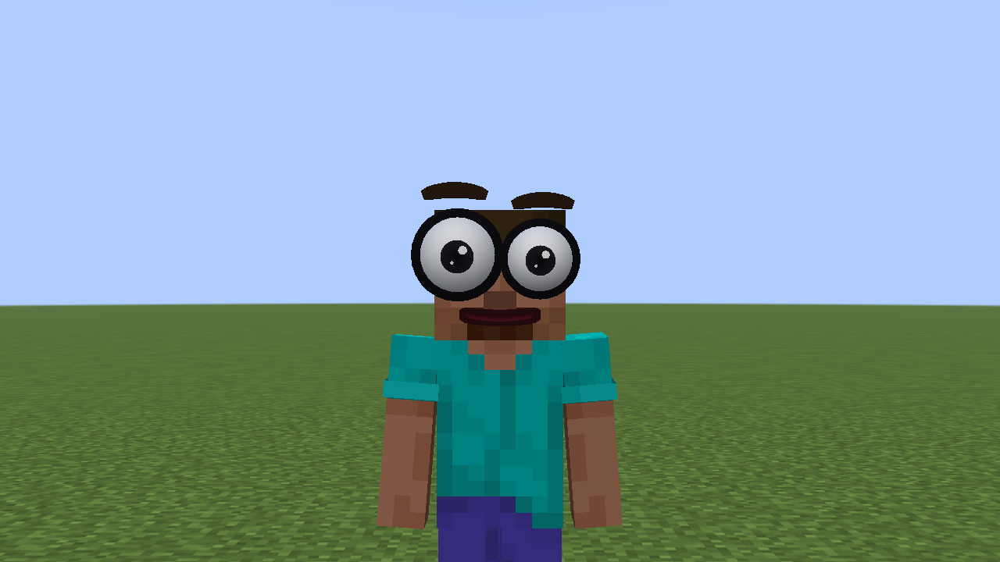
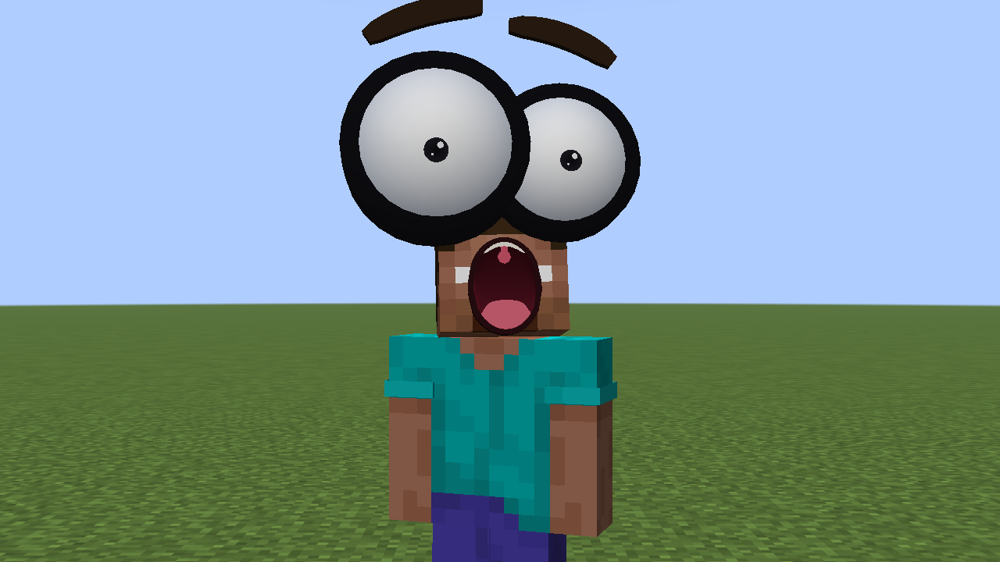
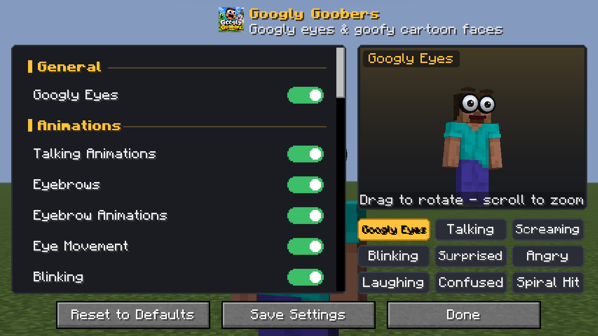
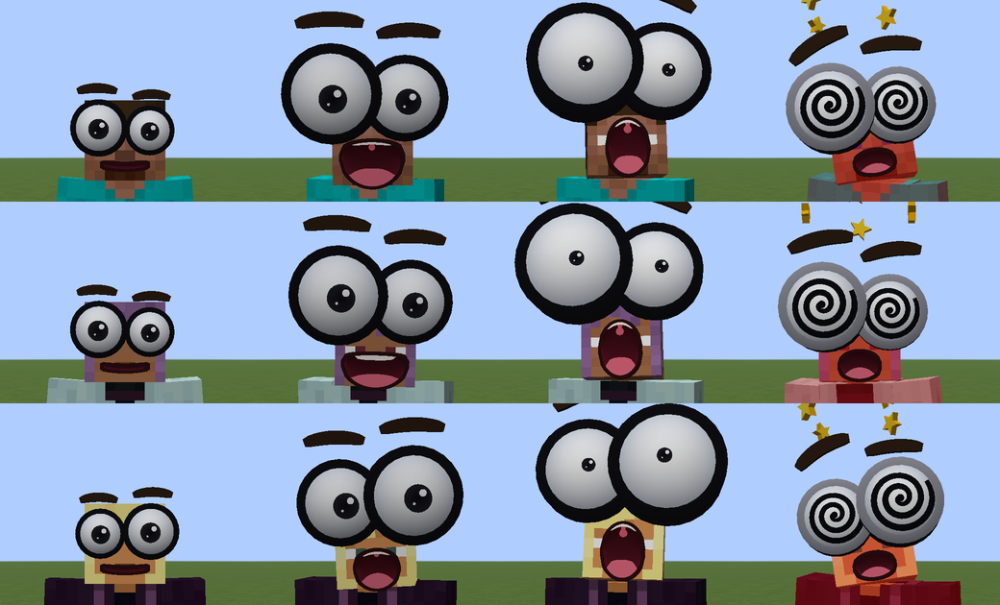

# Googly Goobers

**Huge 3D googly eyes, bouncy cartoon eyebrows and a talking mouth for every Minecraft player.**

When someone talks, their eyes **swell up to about 1.6x** and their mouth flaps **wide open**.
When they scream (`AAAAHHH`, or yelling into Simple Voice Chat) the eyes get even bigger, the
mouth becomes a huge trembling oval and the head shakes. Hit someone and their eyes turn into
**spinning black-and-white spirals** while stars orbit their head.

**Fabric** · **Minecraft 26.3, 26.2 and 1.21.11** · client mod, with optional server-side sync

| Idle | Talking | Screaming | Hit |
| --- | --- | --- | --- |
|  |  |  |  |



## Downloads and requirements

Each Minecraft version has its own jar. Use the one that matches your game; a jar only loads on
its own Minecraft version.

| Minecraft | Jar | Fabric Loader | Fabric API | Java |
| --- | --- | --- | --- | --- |
| **26.3** | [`googly-goobers-1.0.0-mc26.3.jar`](dist/googly-goobers-1.0.0-mc26.3.jar) | 0.20.1 or newer | 0.166.2+26.3 or newer | 25 |
| **26.2** | [`googly-goobers-1.0.0-mc26.2.jar`](dist/googly-goobers-1.0.0-mc26.2.jar) | 0.20.1 or newer | 0.161.0+26.2 or newer | 25 |
| **1.21.11** | [`googly-goobers-1.0.0-mc1.21.11.jar`](dist/googly-goobers-1.0.0-mc1.21.11.jar) | 0.20.1 or newer | 0.141.6+1.21.11 or newer | 21 |

SHA-256 checksums are next to each jar (`.sha256` files) and in [`dist/SHA256SUMS.txt`](dist/SHA256SUMS.txt).

**Optional:** [Mod Menu](https://modrinth.com/mod/modmenu) adds a Configure button in the mod
list. [Simple Voice Chat](https://modrinth.com/plugin/simple-voice-chat) makes mouths move with
real voice volume. Neither is required.

## Installation

1. Install [Fabric Loader](https://fabricmc.net/use/) 0.20.1 or newer for your Minecraft version.
2. Put [Fabric API](https://modrinth.com/mod/fabric-api) and the Googly Goobers jar for your
   Minecraft version into your `mods` folder. Keep only one Googly Goobers jar there.
3. Start the game and press **G** to open the Googly Goobers menu.
4. Optional, for multiplayer sync and operator commands: put the same Googly Goobers jar (and
   Fabric API) on the server.

## Features

**Googly eyes**
- Real 3D eyeballs that stick out of the face: black plastic rim, shaded white dome, big pupils
  with shiny highlights.
- Pupils behave like loose googly-eye discs. They follow where the player looks, glance at you and
  at nearby players, lag behind head turns, drop when landing and bounce off the rim. The two eyes
  move independently.
- Random blinking (sometimes a double blink). Eyes bob with every step and pop and bounce when
  jumping, landing and talking.
- Adjustable eye size, pupil size, eye spacing and movement.

**Talking, screaming and expressions** (big, cartoony and impossible to miss)
- When a player talks, **both eyes swell to about 1.5-1.8x** (with a springy pop when they start,
  a pulse on stressed syllables and a smooth shrink when they stop), the **mouth opens wide** in a
  different shape every syllable (AH, OH, EH, EE, OO), the brows bounce and the head nods.
- **Screaming** (`AAAAHHHH`, `NOOOOO`, `eeeek`, shouted `HELP!!`, `😱`, or yelling into the
  microphone): the eyes grow to about **2x** with tiny terrified pupils, the mouth opens into a huge
  trembling oval, the brows shoot up and the head shakes.
- The face matches the message: laughing (`haha`, `lol`, `xD`), surprised (`wow`, `?!`), shouting
  (ALL CAPS), angry (`grr`, `>:(`), excited (`yay!`), happy (`:)`), confused (`huh?`).
- Works with servers that reformat chat (`[Rank] Name: hi`, `Name » hi`).
- **Voice lip sync** with Simple Voice Chat: louder voice = wider mouth; yelling = screaming face.
- Make faces on purpose with keybinds (surprised, angry, laughing, excited, happy, confused,
  screaming).
- Smooth everywhere: expressions cross-fade, everything moves on springs, big eyes never cover
  the mouth and the mouth never hangs off the chin.

**Hit reactions**
- Taking damage from anything turns the eyes into huge **black-and-white spirals that spin**, the
  mouth drops open in shock, the head wobbles, the body staggers and **cartoon stars orbit the
  head**. A recovery blink brings the normal eyes back.
- A hit interrupts talking; when the reaction ends the face goes back to talking if the player is
  still talking, otherwise to normal.

**Settings menu** (press **G**)
- Every effect has its own switch, plus sliders for sizes, speeds and how exaggerated everything is.
- Changes apply **immediately**. Save Settings, Done and Escape write `config/googlygoobers.json`;
  Reset to Defaults restores everything. Settings survive restarts.
- A **live preview** of your own skin (default skin on the title screen) with 9 preview modes:
  Googly Eyes, Talking, Screaming, Blinking, Surprised, Angry, Laughing, Confused, Spiral Hit.
  Drag to rotate, scroll to zoom into the face.
- **Player Selection**: a searchable list of online players with a Googly Eyes switch for each one.

**Multiplayer**
- Works on any server for **your own screen** (the faces are client-side rendering).
- When the server also has Googly Goobers, your look is **shared** with other players who have the
  mod, talking and expressions are synced, and operators get commands.
- Players without the mod are never affected and always see normal skins.

## Settings

| Section | Settings |
| --- | --- |
| General | Googly Eyes (main switch) |
| Animations | Talking Animations, Eyebrows, Eyebrow Animations, Eye Movement, Blinking, Voice Lip Sync |
| Hit Reactions | Hit Reactions, Spiral Eyes, Head Wobble, Cartoon Stars, Spiral Rotation Speed, Damage Reaction Duration, Reaction Intensity |
| Appearance | Eye Size, Pupil Size, Mouth Size, Eyebrow Size, Eye Spacing, Face Size |
| Talking & Expressions | Eye Enlargement, Mouth Opening, Animation Speed, Overall Exaggeration, Expression Intensity |
| Who Gets Googly Eyes | Apply to Myself, Apply to Everyone, Player Selection |
| Multiplayer | Show Synced Looks, Share My Look, server sync status |

| Talking slider | What it does | Range (default) |
| --- | --- | --- |
| Eye Enlargement | How much the eyes grow when talking and screaming. At 1.00x they reach about 1.6x when talking and 2x when screaming; 0 turns the growth off. | 0 - 2 (1.00x) |
| Mouth Opening | How wide the mouth opens when talking and screaming. | 0.25 - 2 (1.00x) |
| Animation Speed | How fast every animation plays. | 0.5 - 2 (1.00x) |
| Overall Exaggeration | All cartoon motion at once: eye growth and pops, mouth opening, brow bounce, head nods and shakes. | 0.25 - 2 (1.00x) |
| Expression Intensity | How strongly each expression shows its own shape (angry brows, smiles, squints). | 0 - 2 (1.00x) |

## Keybinds

All keybinds are in *Options > Controls > Key Binds > Googly Goobers* and can be rebound.

| Key | Action |
| --- | --- |
| **G** | Open the Googly Goobers menu |
| unbound | Toggle Googly Eyes |
| unbound | Make a Face: Surprised / Angry / Laughing / Excited / Happy / Confused / Screaming |

## Commands

Commands need Googly Goobers on the server. `/googly` is a short alias for `/googlygoobers`.

| Command | Who | What |
| --- | --- | --- |
| `/googlygoobers eyes <players> on\|off\|reset` | operators | Force googly eyes on or off for players (seen by everyone with the mod); `reset` gives the choice back to each player |
| `/googlygoobers react <players>` | operators | Play a spiral-eye hit reaction |
| `/googlygoobers expression <name>` | everyone | Make a face nearby players see (`surprised`, `angry`, `laughing`, `excited`, `happy`, `confused`, `screaming`, ...) |
| `/googlygoobers status` | everyone | List who wears googly eyes (and who doesn't have the mod) |

Forced looks are saved with the world in `googlygoobers_forced_looks.json`.

## What other players see

| You have the mod | Server has the mod | Other player has the mod | Result |
| --- | --- | --- | --- |
| yes | no | - | You see googly eyes on the players you choose. Nobody else sees anything. |
| yes | yes | yes | You see each other's chosen looks; talking and expressions are synced. |
| yes | yes | no | They see your normal skin. Nothing is forced onto players without the mod. |

Hit reactions use the game's own damage events, so they work for every visible player even
without server support. Chat-based talking works on any server.

**What the mod sends:** only when the server also runs Googly Goobers, your client tells the
server whether you show googly eyes, and when you chat or make a face, so other modded players'
faces animate. Nothing is sent to any other server or service, and nothing is sent to servers
without the mod.

## Version differences



*Idle, talking, screaming and hit on Minecraft 26.3 (top), 26.2 (middle) and 1.21.11 (bottom),
captured from the release jars.*

The three jars are built from the same source code and have the same features, settings, menu
and look. The only differences are internal (method and class names that changed between
Minecraft versions, isolated in small compat classes):

- Minecraft 1.21.11 is obfuscated, so its jar is compiled against Mojang's official mappings and
  remapped to Fabric's intermediary names; 26.x is unobfuscated and needs no remapping.
- 1.21.11 runs on Java 21; 26.2 and 26.3 need Java 25.

See [Known limitations](#known-limitations) for anything that was not tested.

## Compatibility and performance

- The face is a render layer attached to the head (like vanilla hats), so it follows all head and
  body animations, crouching and swimming, both arm types and any skin, and mods that pose the head.
- Pushed forward automatically when wearing a helmet, a skull or a carved pumpkin. Hidden for
  invisible players and spectators.
- Faces are only animated while visible (or while an animation is still playing); far-away faces use
  fewer polygons; nothing runs in the background.

## Known limitations

- Fabric only (no Forge/NeoForge/Quilt-specific builds). Minecraft 26.3, 26.2 and 1.21.11 only.
- Other players only see your look if they have Googly Goobers too, and sharing needs the mod on
  the server.
- Voice lip sync is built against Simple Voice Chat's plugin API (2.6.x). The tests load the real
  Simple Voice Chat and check that it loads the Googly Goobers plugin, and feed voice loudness
  through the same code path the plugin uses, but a live microphone and real voice traffic between
  two players could not be tested.
- The automated tests run on a software (CPU) renderer without a GPU, on Linux. Real graphics
  cards, Windows and macOS were not tested.
- The second player in the multiplayer tests is a server-side fake player, not a second real
  client.

## Building

```bash
./gradlew build                  # Minecraft 26.3    -> build/mc26.3/libs/googly-goobers-1.0.0-mc26.3.jar
./gradlew build -Pmc=26.2        # Minecraft 26.2    -> build/mc26.2/libs/googly-goobers-1.0.0-mc26.2.jar
./gradlew build -Pmc=1.21.11     # Minecraft 1.21.11 -> build/mc1.21.11/libs/googly-goobers-1.0.0-mc1.21.11.jar
```

Building needs a Java 25 JDK (it can also compile the Java 21 jar for 1.21.11). Running the game
for 1.21.11 uses a Java 21 runtime, which Gradle finds automatically if it is installed.

`versions/<mc>.properties` holds each version's Minecraft, Fabric API, Mod Menu and Java versions.
Code that differs between Minecraft versions lives in `src/*/java-mc26.x/` (26.2 and 26.3) and
`src/*/java-mc1.21.x/` (1.21.11); everything else is shared.

The in-game texture is made by `tools/generate_textures.py`; the icon, logo and banner by
`tools/make_branding.py` from `branding/source/`.

## Testing

The mod has an automated in-game test suite that launches a real Minecraft client, creates a
world and a dedicated server with a second player, and checks every feature while taking
screenshots:

```bash
./gradlew runClientGameTest [-Pmc=...]              # development environment
./gradlew runProductionClientGameTest [-Pmc=...]    # the release jar in a real Fabric install
tools/run-gametest.sh [-Pmc=...] [task]             # headless Linux (Xvfb + EGL)
```

Run it twice: the second launch also checks that settings survived the restart. Add
`-PextraMods=/path/modmenu.jar,/path/voicechat.jar` to the production run to also check the Mod
Menu and Simple Voice Chat integrations with the real mods. Reports are written to
`build/mc<version>/run/<task>/googly-goobers-test-report.md`.

Results for the released jars (every check passed, nothing crashed):

| Minecraft | Java | Launch 1 | Launch 2 (restart) | With Mod Menu + Simple Voice Chat |
| --- | --- | --- | --- | --- |
| 26.3 | 25 | 141 / 141 | 150 / 150 | 145 / 145 |
| 26.2 | 25 | 141 / 141 | 150 / 150 | 145 / 145 |
| 1.21.11 | 21 | 141 / 141 | 150 / 150 | 145 / 145 |

The results for the released jars are summarised in
[`docs/test-reports/README.md`](docs/test-reports/README.md), with the full reports next to it and
the screenshots in [`docs/screenshots/`](docs/screenshots/).

## Project layout

| Package | System |
| --- | --- |
| `client.render` | 3D face rendering (eye, brow, mouth and star meshes, the face layer) |
| `client.anim` | Animation: springs, eyes (pupils, blinking, bounce), brows, mouth, hit reactions, per-player state |
| `client.config` | Settings and persistence |
| `client.gui` | Menu, preview, player selection |
| `client.target` | Who gets googly eyes |
| `client.talk`, `client.voice` | Chat and voice talking detection |
| `client.compat`, `compat` | The few calls that differ between Minecraft versions |
| `network`, `server`, `client.network` | Multiplayer sync and commands |

The mod id and Java packages are still `eyeball` (from the project's original name, EyeBall Mod)
so existing settings and server data keep working. Players never see it.

## History

Googly Goobers is the continuation of the private EyeBall Mod (1.0.0 and 1.1.0 for Minecraft 26.3
and 26.2). Its complete development history is kept in this repository; the original 26.3 jar is
backed up in [`backup/`](backup/). See [CHANGELOG.md](CHANGELOG.md) for what changed.

## License

No license has been chosen yet. Until one is added, all rights are reserved by the author.

Not an official Minecraft product. Not approved by or associated with Mojang or Microsoft.
