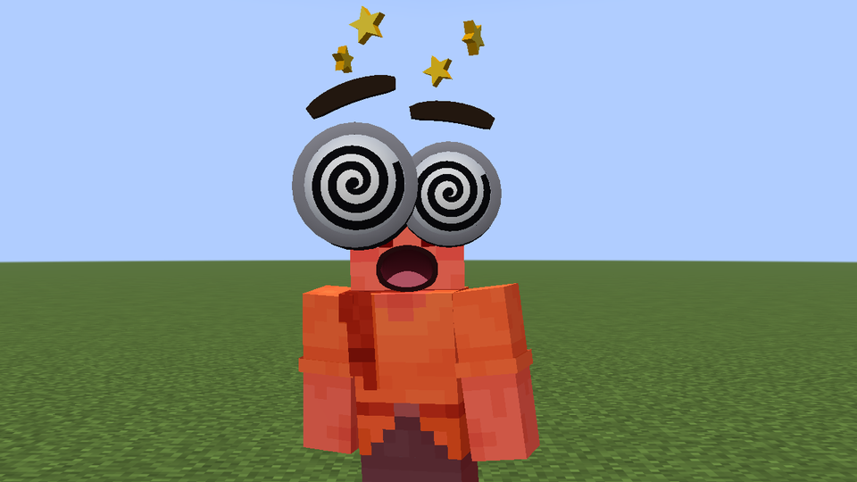
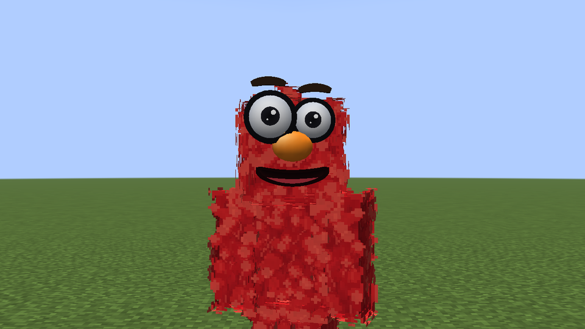

# EyeBall Mod

Gives Minecraft players **enormous 3D googly eyes**, big cartoon eyebrows and a talking mouth.
Hit someone and their eyes turn into **huge spinning hypnotic spirals** while their mouth drops
open in shock. There's also an optional **fluffy red Elmo-style transformation** with the same
facial animations.

**Minecraft 26.3 · Fabric · client + optional server**


| Talking | Hit reaction | Elmo |
| --- | --- | --- |
|  |  |  |


## Features

**Googly eyes**
- Real 3D eyeballs that stick out of the face: black plastic rim, shaded white dome, big pupils
  with shiny highlights. Not a flat image.
- Pupils behave like loose googly-eye discs. They follow where the player looks, glance at you
  and at nearby players, lag behind head turns, drop when landing and bounce off the rim. The two
  eyes move independently, and every player gets slightly different, goofy eye sizes.
- Random blinking (sometimes a double blink), happy squinting.
- Eyes bob with every step and bounce when jumping and landing.

**Talking and expressions**
- When a player chats, their mouth opens and closes syllable by syllable, their eyes get a bit
  bigger, their eyebrows bounce and their head nods.
- The face matches the message: laughing (`haha`, `lol`, `xD`), surprised (`wow`, `?!`),
  shouting (ALL CAPS), angry (`grr`, `>:(`), excited (`yay!`, `let's go`), happy (`:)`),
  confused (`huh?`) and a small talking mouth for short replies.
- Works on servers that reformat chat as system messages (`[Rank] Name: hi`, `Name » hi`).
- **Voice lip sync** with [Simple Voice Chat](https://modrinth.com/plugin/simple-voice-chat):
  mouths follow the actual voice volume of whoever is speaking (optional, not required).
- Make faces on purpose with keybinds (surprised, angry, laughing, excited, happy, confused).

**Eyebrows**
- Oversized arched brows that move up and down, tilt for anger, go one-up-one-down when
  confused, shoot up when surprised, grow bigger when the face gets expressive and wiggle when
  dizzy. They can be hidden, or kept but frozen, separately.

**Hit reaction: spiral eyes**
- Taking damage from anything (players, mobs, falling, fire, explosions) instantly swaps the eyes
  for huge black-and-white spirals that spin, then spin down. The mouth drops open in shock, the
  head wobbles into a dizzy sway, the body staggers, and cartoon stars orbit the head.
- A recovery blink turns the spirals back into normal eyes.
- Priority is strict: a hit interrupts talking, and when the reaction ends the face goes back to
  talking if the player is still talking, otherwise to normal.

**Elmo-style transformation**
- A separate mode with an original model: oversized rounded head, red fur (3 layers of fur
  "shells" for a fluffy silhouette), big googly eyes, an orange oval nose and a big black mouth.
- Talks with its mouth, head and arms, blinks, bounces when walking, and gets spiral eyes when
  hit. In first person your arms become red and furry.
- Works together with or independently of the googly eyes.

**Choose who gets what**
- Googly eyes and Elmo each have their own **Apply to Myself** and **Apply to Everyone** switch.
- **Player Selection**: turn either effect on or off for individual players.

**Multiplayer**
- Works on any server for **your own screen** (the effects are client-side rendering).
- When the server also has EyeBall, your chosen look is **shared**: other players with EyeBall
  see you with googly eyes / as Elmo, and talking and expressions are synced.
- Operators get `/eyeball` commands to apply looks to players for everyone with the mod.
- Players without the mod are never affected and always see normal skins.

## Installation

**Download:** [`dist/eyeball-1.0.0.jar`](dist/eyeball-1.0.0.jar) (or build it yourself, see below).

1. Install [Fabric Loader](https://fabricmc.net/use/) 0.20.1 or newer for **Minecraft 26.3**.
2. Put [Fabric API](https://modrinth.com/mod/fabric-api) and `eyeball-1.0.0.jar` in your `mods` folder.
3. Optional: [Mod Menu](https://modrinth.com/mod/modmenu) (adds a Configure button in the mod
   list) and Simple Voice Chat (voice lip sync).
4. Optional, for multiplayer sync: put the same `eyeball-1.0.0.jar` (and Fabric API) on the server.

Java 25 is required (the same as Minecraft 26.3).

## Using it

Press **G** to open the menu (rebind it in *Options > Controls > Key Binds > EyeBall Mod*).

| Section | Settings |
| --- | --- |
| Modes | Googly Eyes, Elmo Transformation |
| Animations | Talking Animations, Eyebrows, Eyebrow Animations, Eye Movement, Blinking, Voice Lip Sync |
| Hit Reactions | Hit Reactions, Spiral Eyes, Head Wobble, Cartoon Stars, Spiral Rotation Speed, Damage Reaction Duration, Reaction Intensity |
| Appearance | Eye Size, Pupil Size, Mouth Size, Eyebrow Size, Eye Spacing, Character Size, Animation Speed, Expression Intensity |
| Who Gets The Effects | Apply to Myself / Apply to Everyone (separately for Googly and Elmo), Player Selection |
| Multiplayer | Show Synced Looks, Share My Look, server sync status |

- Every switch and slider applies **immediately**; turning something OFF makes it disappear at once.
- **Save Settings** writes `config/eyeball.json`; Done and Escape also save. **Reset to Defaults** restores everything.
- The **preview** on the right shows your own skin with the selected preview: Googly Eyes,
  Talking, Blinking, Surprised, Angry, Spiral Hit, Elmo, Elmo Talk, Elmo Hit. Drag to rotate,
  scroll to zoom into the face. It works from the title screen too.

**Keybinds** (all rebindable): Open EyeBall Menu (G), Toggle Googly Eyes, Toggle Elmo
Transformation, and Make a Face: Surprised / Angry / Laughing / Excited / Happy / Confused
(unbound by default).

**Commands** (only when the server has EyeBall):

| Command | Who | What |
| --- | --- | --- |
| `/eyeball googly <players> on\|off\|reset` | operators | force googly eyes on players for everyone with the mod |
| `/eyeball elmo <players> on\|off\|reset` | operators | force the Elmo transformation |
| `/eyeball react <players>` | operators | play a spiral-eye hit reaction |
| `/eyeball expression <name>` | everyone | make a face nearby players see |
| `/eyeball status` | everyone | list who wears what (and who doesn't have the mod) |

Forced looks are saved with the world (`eyeball_forced_looks.json`).

## What other players see

| You have EyeBall | Server has EyeBall | Other player has EyeBall | Result |
| --- | --- | --- | --- |
| yes | no | - | You see effects on players you choose. Nobody else sees anything. |
| yes | yes | yes | Both of you see each other's chosen looks, talking and expressions synced. |
| yes | yes | no | They see your normal skin. Nothing is forced onto players without the mod. |

Hit reactions are detected from the game's own damage events, so they work for every visible
player even without server support. Chat-based talking works on any server.

## Compatibility and performance

- Built for Minecraft 26.3 with Fabric API only. No other libraries.
- The face is drawn as a render layer attached to the head bone (like vanilla hats and skulls),
  so it follows all head and body animations, crouching and swimming, both arm types (wide/slim)
  and any skin. It also follows mods that pose the head.
- Pushed forward automatically when wearing a helmet, a skull or a carved pumpkin. Hidden for
  invisible players and spectators (no floating eyes giving anyone away).
- The Elmo renderer is only used for players who are Elmo on your screen; everyone else goes
  through the vanilla renderer untouched.
- Performance: faces are only simulated while visible (or while an animation is still playing);
  far-away faces use fewer polygons; nothing runs in the background. See the test report below
  for measured numbers.

## Building

```bash
./gradlew build
```

The mod jar is written to `build/libs/eyeball-1.0.0.jar`. Textures are generated by
`tools/generate_textures.py` (all original; nothing is copied from other mods or packs).

## Testing

The mod ships with an automated in-game test suite that launches a real Minecraft client,
creates a world and a dedicated server, and checks every feature while taking screenshots:

```bash
./gradlew runClientGameTest          # desktop
./tools/run-gametest.sh              # headless Linux (Xvfb + EGL)
```

The report is written to `build/run/clientGameTest/eyeball-test-report.md`. Run it twice: the
second launch also checks that settings survived the restart.

The suite has 99 checks, grouped into 15 areas:
- the title-screen menu
- googly rendering
- pupil movement (each eye independently)
- blinking
- talking and the 9 chat-detected expressions
- deliberate expressions and eyebrows
- the hit reaction (spirals appear, rotate, finish and return to normal)
- animation priority while talking
- every individual setting
- Elmo (including first person)
- the main ON/OFF switches
- the menu with all 9 preview modes, Save, Reset and Player Selection
- multiplayer against a real dedicated server with a second player (shared looks, `/eyeball`
  commands, remote talking, relayed expressions, remote spiral eyes, synced Elmo, per-player choices)
- performance with 14 animated players, including off-screen culling
- settings persistence across a restart

The latest report and screenshots are in [`docs/test-report.md`](docs/test-report.md) and
[`docs/screenshots`](docs/screenshots). Measured on a CPU-only software renderer (no GPU), a
face costs about 70 microseconds of CPU per frame. Faces that are off screen cost nothing.

A standalone dedicated server (`./gradlew runServer`) also starts cleanly with the mod; it
needs no client classes.

## Project layout

| Package | System |
| --- | --- |
| `client.render` | 3D facial rendering (eye, brow, mouth, nose and star meshes, the face layer) |
| `client.anim` | Animation: springs, eye animator (pupils, blinking, bounce), brow animator, mouth animator, damage reaction, per-player face state with priority |
| `client.render.elmo` | Elmo transformation (model, fur shells, renderer) |
| `client.config` | Settings and persistence |
| `client.gui` | Menu, preview, player selection |
| `client.target` | Who gets which effect |
| `client.talk`, `client.voice` | Chat and voice talking detection |
| `network`, `server`, `client.network` | Multiplayer synchronisation and commands |

## Notes

The Elmo-style transformation is an unofficial, fan-made tribute built from original models and
textures. It is not affiliated with or endorsed by Sesame Workshop.
