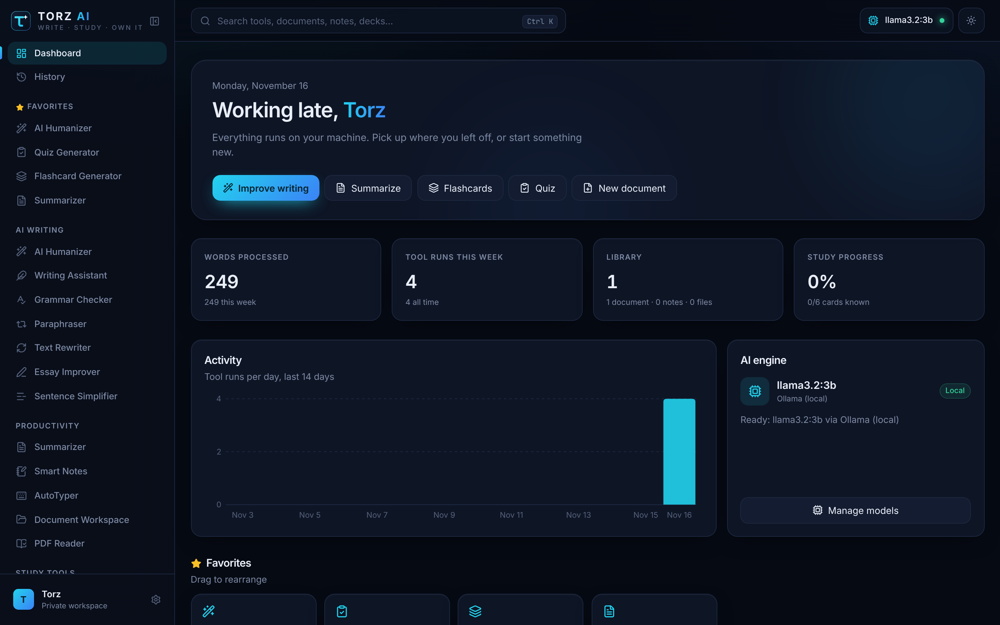

# TORZ AI

**Your own private AI writing and study platform.** Seventeen tools — a humanizer, grammar checker,
paraphraser, summarizer, smart notes, quizzes, flashcards, study guides, practice tests, document Q&A,
an AutoTyper and more — running on your own computer. No account, no subscription, no word credits,
no daily caps, no ads, no tracking.



- **Private by design.** The app, database and documents live on your PC. It listens only on
  `127.0.0.1`, and every API call needs a per-install token.
- **Free local AI.** Built for [Ollama](https://ollama.com) — free models that run on your own machine.
  LM Studio, llama.cpp and other OpenAI-compatible servers work too. OpenAI, Anthropic and Google Gemini
  are optional extras that need your own API key and have their own pricing.
- **Useful even without AI.** Grammar checking, summaries, notes, quizzes, flashcards, study guides and
  document search also have an **offline engine**. It builds results from the sentences in your own
  material, and its output is always labelled “Offline engine”.
- **Honest output.** Every result shows which model produced it. If no model is connected, the AI tools
  say so and show how to set one up. Nothing is faked.

---

## Quick start (Windows 10 / 11)

1. **Install.** Double-click **`INSTALL.bat`**. It:
   - finds Python 3.10–3.14, or offers to install Python 3.12 with `winget`;
   - creates a private environment in `backend\.venv` and installs the dependencies;
   - adds the offline OCR engine for scanned PDFs;
   - creates a **TORZ AI** shortcut on your desktop;
   - offers to install **Ollama** and download the recommended model `llama3.2:3b` (about 2 GB).
2. **Start.** Double-click **`START.bat`** (or the desktop shortcut). Your browser opens
   `http://127.0.0.1:8765`.
   - `START.bat --app-window` opens TORZ AI in its own window without browser tabs (uses Edge).
3. **Stop.** Double-click **`STOP.bat`**. This shuts the server down cleanly.

Node.js is **not** needed: the interface comes pre-built in `frontend/dist`.

On macOS or Linux, use `./install.sh`, `./start.sh` and `./stop.sh` instead.

## Setting up local AI (free)

1. Install Ollama from <https://ollama.com/download> (INSTALL.bat can do this for you).
2. In TORZ AI, open **Settings → AI models → Ollama** and click **Download** on a recommended model:

| Model | Download | Good for |
| --- | --- | --- |
| `llama3.2:3b` | 2.0 GB | Recommended start. Fast and needs about 8 GB of RAM. |
| `qwen2.5:7b` | 4.7 GB | Higher quality and very reliable quizzes and flashcards. Needs about 16 GB of RAM. |
| `gemma3:4b` | 3.3 GB | Natural, fluent rewriting. |
| `llama3.1:8b` | 4.9 GB | Strong general writing on capable PCs. |
| `qwen2.5:1.5b` | 1.0 GB | Older or low-memory PCs. Lower quality. |

Any other model from the Ollama library works too: type its name under “Other model”. With a GPU,
generation is many times faster than on a CPU alone.

### Other providers (optional)

| Provider | Cost | Setup |
| --- | --- | --- |
| **LM Studio / llama.cpp / Jan / vLLM** | Free and local | Settings → AI models → *OpenAI-compatible server*. Enter the address, for example `http://127.0.0.1:1234/v1`. |
| OpenRouter, Groq, Together, DeepSeek… | Their own pricing | *OpenAI-compatible server*. Enter their base URL and your API key. |
| OpenAI | Paid per use | Paste an API key, then pick a model from the list. |
| Anthropic | Paid per use | Paste an API key, then pick a model. |
| Google Gemini | Limited free tier, then paid | Paste an API key from AI Studio. |

API keys are kept in **Windows Credential Manager**. If that isn't available, they go in an
AES-encrypted file in the data folder. Keys are never sent to the browser. If a cloud provider fails,
TORZ AI can **fall back to your local Ollama model** automatically. You can turn this off.

---

## The tools

**AI Writing**

| Tool | What it does |
| --- | --- |
| AI Humanizer | Rewrites stiff text so it reads naturally. Three modes: Simple, Standard and Enhanced. Options keep your meaning, key vocabulary, citations, quotations, paragraphs and length. Tone can be kept, made more conversational or made more formal. You get a side-by-side comparison, highlighted changed sentences, and a *preservation check* that confirms citations, quotes, numbers and key terms survived. It focuses on writing quality and never claims AI-detector scores. |
| Writing Assistant | A rich-text editor with an AI panel. Select text and choose an action: improve, fix grammar, fix awkward sentences, rewrite, expand, shorten, continue, improve vocabulary or transitions, strengthen the intro or conclusion, or change the tone. You can also type a custom request. Each change can come with an explanation. It can also write an essay draft or explain your mistakes. Results are previewed before *Replace* or *Insert below*. |
| Grammar Checker | Inline wavy underlines with suggestions. Accept, reject or accept all. AI mode explains each correction. The offline rule engine covers spelling, a/an, agreement, verb forms, repeated words, capitalization and punctuation, and it uses your personal dictionary. |
| Paraphraser | Six styles: Standard, Academic, Simple, Professional, Conversational and Concise. A 1–5 strength slider sets how much changes, and you can list words that must not change. |
| Text Rewriter | Rewrites for a new tone, length or audience, with your own instructions. |
| Essay Improver | Instructor-style feedback scores thesis, structure, evidence, clarity, grammar and style. Then you get a revised essay with every change highlighted. |
| Sentence Simplifier | Rewrites at the reading level you choose, with readability scores before and after. The scores are calculated locally. |

**Productivity**

| Tool | What it does |
| --- | --- |
| Summarizer | Works on pasted text, PDF, DOCX, TXT or Markdown. Formats: short, detailed, bullets, paragraph, key facts, main arguments or key vocabulary. Length is adjustable. Long documents are summarized section by section and then combined. |
| Smart Notes | Organized notes covering the topic, overview, concepts, definitions, key information, dates, people, examples, arguments and things to remember. Notes are editable and searchable, can be tagged and pinned, and export to MD, DOCX, PDF or TXT. |
| AutoTyper | Types prepared text into Google Docs or any web editor at an adjustable speed, with optional natural rhythm and pauses after punctuation. Start, pause, resume, stop and undo. See [AutoTyper](#autotyper). |
| Document Workspace | Documents with folders, search, sorting, pinning, autosave, version history, trash and restore, import from PDF, DOCX, TXT or MD, and export to DOCX, PDF, MD, TXT or HTML. |
| PDF Reader | Shows the PDF pages next to the extracted text. Re-run OCR on scanned pages, then send the file to any study tool in one click. |

**Study Tools**

| Tool | What it does |
| --- | --- |
| Quiz Generator | Multiple choice, true/false, short answer, fill in the blank and definitions, at easy, medium, hard or mixed difficulty. You answer one question at a time with instant feedback, explanations and the supporting quote. Then you see your score and results, can review wrong answers, and can retake or generate new questions. Questions the material doesn't support are discarded automatically. |
| Flashcard Generator | 3D flip cards with previous/next, shuffle, Know it / Difficult, a “difficult only” mode, and a quiz mode with shuffled answers. Progress is tracked per card. You can edit cards and import or export decks as JSON, CSV or Anki TSV. |
| Study Guide Generator | Unit overview, topics, vocabulary, key concepts, examples, facts, common mistakes and review questions. Read it as a **quick review** or a **detailed study** guide. Exports to PDF or DOCX. |
| Practice Test Generator | Full tests with an optional timer that submits automatically when time runs out. Objective questions are graded instantly. Written answers get AI feedback, or approximate grading offline. Includes test history and retakes with new questions. |
| Question Answering | Ask about your documents, notes, files or pasted text. Answers cite the passages they come from, like [1] [2]. Offline mode shows the most relevant passages instead. |

Plus: **History** for every tool (search, rename, delete, reuse an input, clear), **Favorites**
(shown in the sidebar and on the dashboard, drag to reorder), **global search** (Ctrl+K), dark/light
themes, six accent colors, text sizes, compact layout and reduced motion.

---

## Browser extension

The `extension/` folder is a Chrome / Edge **Manifest V3** extension.

**Install it once:** open `chrome://extensions` (or `edge://extensions`), turn on **Developer mode**,
click **Load unpacked** and choose the `torz-ai\extension` folder. On the AutoTyper page, TORZ AI
then shows “Connected”.

What it does:

- **Right-click selected text → TORZ AI.** Improve writing, rewrite naturally, paraphrase, fix
  grammar, summarize, or send the text to TORZ AI as a new document. The result opens in the side
  panel. **Replace selection** only happens when you click it, and there is an **Undo replace**
  button. Ctrl+Z works too.
- **Side panel** (toolbar icon or `Alt+Shift+T`). Paste-and-run assist, the AutoTyper, and settings.
- **Permissions.** `storage`, `contextMenus`, `sidePanel`, `scripting`, `activeTab`, `debugger`, and
  access to `127.0.0.1` / `localhost` only, to reach your TORZ AI app. The extension reads a page only
  when you use one of its menu items or start typing.

## AutoTyper

Prepare text in **TORZ AI → AutoTyper**: paste it, or pick a document, note or earlier result. Set
the speed, preview the typing, then choose where it goes:

1. **Browser extension — any website, including Google Docs.** Click *Send to extension*. Open your
   document and click where the text should go. Open the TORZ AI side panel and press **Start
   typing**. You get a 3-second countdown to click back into the page.
   - **Keyboard engine** (default). Sends real keystrokes through Chrome's debugging protocol. This
     is the only reliable way to type into Google Docs, which ignores text inserted by scripts. While
     it types, Chrome shows a “TORZ AI started debugging this browser” banner. Closing the banner
     stops typing instantly. Undo sends Ctrl+Z.
   - **Compatibility engine.** Right-click inside a normal text field, choose *TORZ AI → Type
     prepared text here*, then press Start. It uses the browser's own text insertion, so native undo
     works, and its Undo button restores the field. It does not work in Google Docs.
2. **Google Docs API — official integration.** Text is inserted with Google's own Docs API, with
   pause, resume, stop and undo (removes the inserted text). One-time setup, free:
   1. In [Google Cloud Console](https://console.cloud.google.com/), create a project and enable the
      **Google Docs API** and **Google Drive API**.
   2. On the OAuth consent screen, choose **External** and add yourself as a **test user**.
   3. Under Credentials, create an **OAuth client ID** of type **Desktop app**, then download the JSON.
   4. In TORZ AI → AutoTyper → *Google Docs API*, paste the JSON, click **Connect Google account**,
      and approve.
   Google allows about one edit per second, so text is inserted in short bursts at the end of the
   document. Google expires apps in “testing” mode every 7 days, after which you reconnect.

TORZ AI types only after you press Start, only into the document you chose, and you can pause or
stop at any time.

---

## Your data

| What | Where (Windows) |
| --- | --- |
| Database (documents, notes, decks, quizzes, history, settings) | `%LOCALAPPDATA%\TORZ AI\torz.db` (SQLite) |
| Uploaded files | `%LOCALAPPDATA%\TORZ AI\files\` |
| Logs | `%LOCALAPPDATA%\TORZ AI\logs\` |

On macOS the data lives in `~/Library/Application Support/TORZ AI`, and on Linux in
`~/.local/share/torz-ai`. Set `TORZ_DATA_DIR` to use a different folder.

**Settings → Privacy & data** has storage usage, *Export all data* (ZIP), *Clear history*,
*Delete all documents*, *Reset application*, and a switch to stop saving history. Nothing is
uploaded anywhere. The only outbound calls go to the AI provider you choose, and to Google if you
connect Google Docs.

## Configuration

| Environment variable | Default | Purpose |
| --- | --- | --- |
| `TORZ_PORT` | `8765` | Port of the local server. If you change it, also update the address in the extension's Settings tab. |
| `TORZ_DATA_DIR` | see above | Data folder. |
| `TORZ_OLLAMA_URL` | `http://127.0.0.1:11434` | Default Ollama address, for example an Ollama running on another PC. |
| `TORZ_MAX_UPLOAD_MB` | `50` | Upload size limit per file. |

## Troubleshooting

- **“No AI model is connected”.** Start Ollama, either from the Start menu or with `ollama serve`.
  Then open Settings → AI models, download a model, and press *Test connection*.
- **Generation is slow.** Choose a smaller model (`llama3.2:3b` or `qwen2.5:1.5b`), or use a PC with
  a GPU.
- **Quizzes or flashcards have fewer items than requested.** Items the material doesn't clearly
  support are discarded. Use longer material or a larger model.
- **Port 8765 is in use.** Set `TORZ_PORT` to another port, for example `set TORZ_PORT=8780` before
  running START.bat.
- **A scanned PDF has no text.** Open it in the PDF Reader and click *Re-read with OCR*. Check
  Settings → System that OCR is installed.
- **Diagnostics.** Settings → System → *Run diagnostics* checks the database, disk, OCR, key storage
  and AI connection.

## Development

```text
torz-ai/
  backend/      FastAPI app (package `torz`), SQLite, AI providers, offline engine, documents, tests
  frontend/     React + TypeScript + Vite + Tailwind; production build in frontend/dist
  extension/    Chrome MV3 extension
  e2e/          Playwright end-to-end tests
```

To run the backend tests, from `backend`:

```bash
.venv/bin/python -m pytest
```

Add `TORZ_LIVE_OLLAMA=1` and `-m live` to run the live tests, which need a running Ollama.

To typecheck, run the unit tests and build, from `frontend`:

```bash
npm run typecheck && npm test && npm run build
```

To run the end-to-end tests, from `e2e`:

```bash
npm test
```

`npm run test:live` uses your real Ollama instead of the built-in test model.

For a dev server with hot reload, start the backend with `TORZ_DEV=1 python -m torz.launcher run`
and the frontend with `npm run dev`, then open `http://localhost:5173`.

See `IMPLEMENTATION_PLAN.md` for the architecture, `TEST_RESULTS.md` for the latest test runs, and
`BUILD_STATUS.md` for feature status and known limitations.
